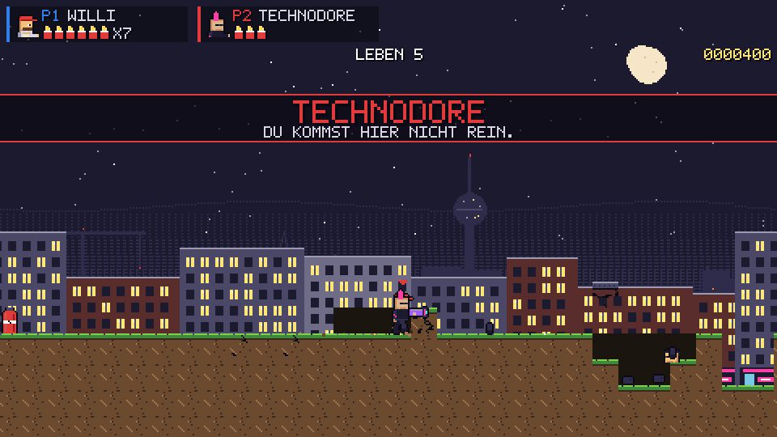

# Berlin Expendables

4-Spieler-Lokal-Koop-Run'n'Gun für **Unreal Engine 5.8** in opulenter HD-Pixel-Art mit 3D-VFX: **Broforce**-Chaos (zerstörbare Welt, Bro-Wechsel) trifft **Metal-Slug**-Spektakel (Waffen-Pickups, Fahrzeuge, Riesen-Bosse) in einem überzeichneten Berlin.



| Dokument | Inhalt |
| --- | --- |
| [docs/KONZEPT.md](docs/KONZEPT.md) | Game-Design: Säulen, Bros, Gegner, Welten, Regeln, Art Direction |
| [docs/ABLAUF.md](docs/ABLAUF.md) | UE-5.8-Architektur, Asset-Pipeline (AutoSprite, ComfyUI, Spritegen, Pixelize), Levelformat, Meilensteine |
| [docs/MCP_RUNBOOK.md](docs/MCP_RUNBOOK.md) | **Start hier:** Session lokal fortführen, Unreal-/AutoSprite-/ComfyUI-MCP verbinden, erste Editor-Session |
| [docs/STYLEGUIDE.md](docs/STYLEGUIDE.md) | Pixel-Art-Regeln, Palette „Berlin Nacht", VFX-Regeln |
| [docs/PROMPTS_AUTOSPRITE.md](docs/PROMPTS_AUTOSPRITE.md), [docs/PROMPTS_COMFYUI.md](docs/PROMPTS_COMFYUI.md) | Bestell-Listen für KI-Assets |

## Unreal-Projekt

```
BerlinExpendables.uproject   Source/BerlinExpendables (C++)   Content/Python (Editor-Automation)   Content/Import (Atlanten)
```

1. Repo klonen, `git lfs install`, Projekt in UE 5.8 öffnen, C++ kompilieren lassen.
2. Im Editor `py be_build_all.py` ausführen: importiert Sprites, baut Flipbooks, Materialien, DataAssets, die Map `L_Kreuzberg01` und trägt alles in die Projekteinstellungen ein.
3. Play. Beitreten per `K` (Tastatur 1), `.` (Tastatur 2) oder Gamepad-A. `F1` = Debug.

Die ausführliche Checkliste inklusive MCP-Einrichtung steht in [docs/MCP_RUNBOOK.md](docs/MCP_RUNBOOK.md). Der C++-Code wurde ohne Compiler geschrieben; die erste Editor-Session ist eine Kompilier-Runde.

## Werkzeuge (Node/Python, laufen überall)

```bash
npm install
npm run assets     # Spritegen: Platzhalter (2x) nach Content/Import/Placeholder + Prototyp-Assets
npm run dev        # Web-Prototyp (Gameplay-Referenz) unter http://127.0.0.1:5173
npm run check      # Assets + Typecheck + Prototyp-Build
python3 Tools/pixelize/pixelize.py in.png out.png --width 64 --outline --normals out_n.png
```

## Steuerung

| Aktion | Tastatur P1 | Tastatur P2 | Gamepad |
| --- | --- | --- | --- |
| Laufen / Zielen hoch / Ducken | W A S D | Pfeile | Stick / D-Pad |
| Feuer | J | , | X / RT |
| Sprung (und Beitreten) | K | . | A |
| Granate | L | / | Y / RB |
| Nahkampf | U | M | B / LB |


