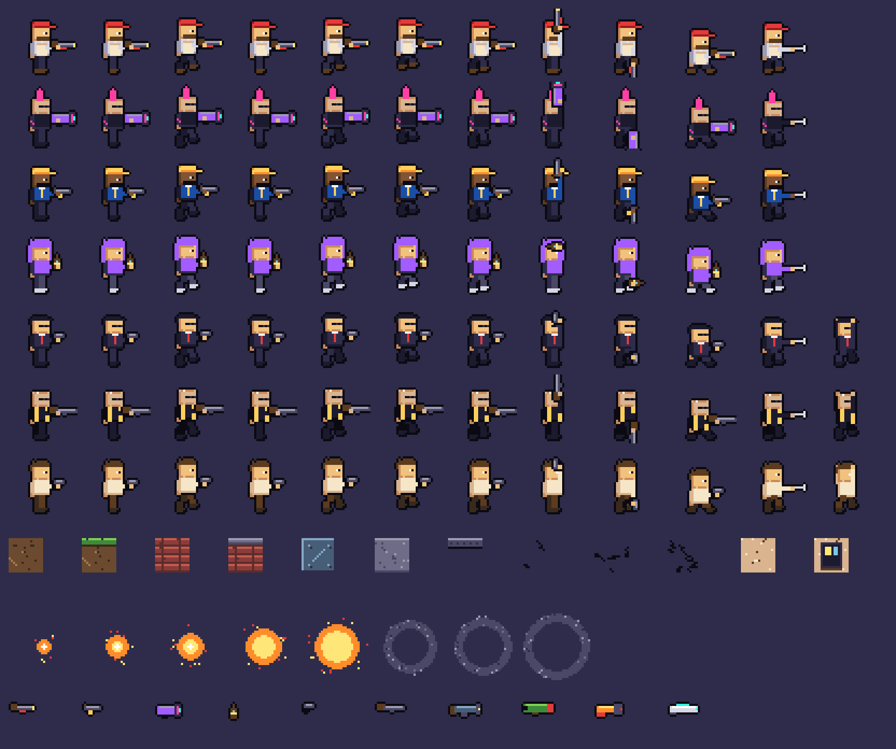
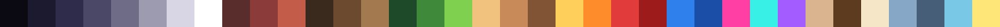

# Pixel-Art-Styleguide „Berlin Nacht"

Verbindlich für alle Assets – ob aus dem Spritegen, aus AutoSprite oder von Hand.

## 1. Grundregeln

1. **Auflösung:** Das Spiel zeigt 640×360 Welteinheiten (1 Einheit = 1 Texel) und skaliert ganzzahlig (1080p = 3×, 1440p = 4×, 4K = 6×). Jedes Asset wird für 1× gezeichnet und muss bei 1× lesbar sein. Der Web-Prototyp nutzt die halbe Größe (480×270, 16-px-Tiles); seine Assets werden für die Engine 2× nearest-neighbor skaliert.
2. **Raster:** 1 Spielpixel = 1 Asset-Pixel. Keine Sub-Pixel, kein Anti-Aliasing, keine Weichzeichner, keine Verläufe (Dithering erlaubt: Bayer 2×2 wie im Himmel).
3. **Palette:** ausschließlich die 36 Farben unten (`public/assets/palette.json`). Neue Farbe = Diskussion + Eintrag in `tools/spritegen/palette.ts`.
4. **Outline:** 1 px `ink` (#0b0a12) um Figuren, Waffen, Props, Items. Tiles haben **keine** Outline (sie kacheln), Partikel auch nicht.
5. **Licht:** von oben links. Helle Kante oben/links (`ash`, `mossLight`, `brickLight`), Schatten unten/rechts.
6. **Transformationen:** Spiegeln nur horizontal. Rotation nur in 90°-Schritten (Waffen, Kugeln). Keine Skalierung außer ganzzahlig (Text, Banner).
7. **Lesbarkeit vor Detail:** Silhouette zuerst. Spieler haben Marker in Spielerfarbe über dem Kopf; Gegner sind farblich uniform (dunkle Anzüge + roter Akzent).

## 2. Palette

| Name | Hex | Verwendung |
| --- | --- | --- |
| ink | #0b0a12 | Outlines, tiefstes Schwarz |
| night | #1b1a2e | Nachthimmel, Anzüge |
| navy | #2e2c4a | Skyline-Silhouette, Schatten |
| slate | #4a4866 | Beton-Schatten, Waffen |
| concrete | #6e6c87 | Beton |
| ash | #9d9bb0 | Beton hell, Glanz |
| fog | #d8d6e4 | fast weiß, Willis Hemd |
| white | #ffffff | Highlights, Text |
| brickDark / brick / brickLight | #5a2d2d / #8c3b3b / #c45c4a | Ziegel |
| soilDark / soil / soilLight | #3a2a1e / #6b4a2f / #a37a4f | Erde |
| mossDark / moss / mossLight | #1f4a2a / #3f8a3a / #7fd04f | Gras, Spieler 3 |
| skin / skinShade / skinDark | #f1c27d / #c98a5a / #805434 | Hauttöne |
| bvgYellow | #ffcf5c | BVG, Spieler 4, HUD-Akzente |
| orange | #ff8c2a | Natriumdampflicht, Explosion, Currywurst |
| red / blood | #e23b3b / #9d1b1b | Spieler 2, Gegner-Akzent, Blut |
| blue / blueDark | #2f80ed / #1b4ea6 | Spieler 1, BVG-Uniform |
| neonPink / neonCyan / purple | #ff3fa4 / #38f0e6 / #a35cff | Club, Neon, Doro, Sven |
| beige / brown / cream | #d9b48f / #5c3b1e / #f5e6c8 | Putz, Holz, Schürze |
| steel / steelDark | #87a7c7 / #465e78 | Stahl, Käfig |
| glass | #78c8e6 | Fenster, Flaschen |
| gold | #ffe678 | Punkte, Fenster-Licht, Mündungsfeuer |

## 3. Figuren

- **Frame 64×64, Kollisionsbox 20×44** (geduckt 20×34), Füße auf y = 61 (Prototyp: 32×32, Box 10×22, Füße y = 29). Platzhalter sind 3 Köpfe hoch; **AutoSprite-Figuren dürfen detaillierter sein (Metal-Slug-Proportion ≈ 4 Köpfe), müssen aber dieselbe Box, Fußlinie und Handposition einhalten.**
- **Blick nach rechts** zeichnen, links wird gespiegelt. Ein Auge (1 px `ink` + 1 px `white`), Sonnenbrille = 5-px-Strich.
- **Animation-Timing:** idle 4 Frames à 12 Ticks, run 8 à 5, melee 3 (4/5/3 Ticks), panic 4 à 5. Sprung/Fall je 1 Frame. Zielrichtungen `h`/`u`/`d` als eigene Frames.
- **Waffen separat** mit Griff- und Mündungsanker; Körper exportiert den Hand-Anker. Waffe liegt *vor* der Hand, die Hand (2×2 Hautpixel) wird darüber gezeichnet.
- **Tod:** keine Sterbeanimation, sondern Gibs (Kopf, Torso, Bein) + Blut/Konfetti-Partikel. Gegner haben zusätzlich `panic`.
- **Unterscheidbarkeit:** jeder Bro braucht eine einzigartige Silhouette oben (Kappe, Irokese, Kapuze, BVG-Mütze) **und** eine Akzentfarbe.

## 4. Tiles & Welt

- 32×32 in der Engine (16×16 im Prototyp), kachelbar. Oberkanten automatisch (`dirt_top`, `brick_top`). Schaden zeigt sich im Prototyp über Riss-Overlays, in der Engine über Abdunkeln per Instanz-Daten (Risse folgen).
- Zerstörte Kacheln hinterlassen dunkles Erdreich (#1b1510), damit Krater Tiefe haben.
- Hintergrund-Tiles (Putz, Fenster, Ziegel, Graffiti) sind matter und kontrastärmer als Vordergrund.
- Parallax: Himmel (statisch), Skyline 0,15, Häuserzeile 0,4. Hintergründe bleiben in `night`/`navy`/`slate` mit wenigen `gold`-Fenstern – der Vordergrund hat die Sättigung.

## 5. Effekte & 3D-VFX

- **Regel:** Pixel-Art-Elemente (Sprites, Tiles) bleiben auf dem Raster; **Licht, Bloom, Niagara-Partikel und 3D-Trümmer dürfen darüber liegen** und in voller Auflösung rendern. Das ist gewollt und macht den Look „opulent“.
- Explosionen: Niagara-Sprite-Sheet (8 Frames) + GPU-Funken + Rauchring + Light-Renderer (orange, 0,3 s); zusätzlich physikalische Trümmerwürfel in Tile-Farbe.
- Sprites sind beleuchtet: Normalmaps aus `pixelize.py --normals`, kühles Grundlicht, warme Punktlichter aus Waffen und Explosionen. Keine Schatten (Ortho-Kamera), dafür Emissive für Neon.

- Explosion 8 Frames: Weißkern → Gold → Orange → Rauchring (`slate`/`ash`), plus Pixel-Partikel.
- Mündungsfeuer 3 Frames, Rauch 4 Frames, Blut = 1–2-px-Partikel mit Schwerkraft und Bounce.
- Screen-Shake klein (Waffen 0,05–0,25) bis groß (Explosion 0,5), Hitstop 3–4 Frames.

## 6. Schrift & UI

- 5×7-Bitmap-Font, 6 px Vorschub, Großbuchstaben, Umlaute als AE/OE/UE/SS. HUD-Text mit 1-px-Schatten.
- Banner skalieren ganzzahlig (2×/3×/4×). Halbtransparente Balken (`rgba(11,10,18,0.6)`) statt Boxen mit Rand.

## 7. Checkliste für KI-generierte Assets (AutoSprite & Co.)

- [ ] Auf 32-px-Raster heruntergerechnet (Nearest Neighbor), keine Zwischenfarben
- [ ] Auf Palette quantisiert, max. 12 Farben pro Figur
- [ ] 1-px-`ink`-Outline, keine doppelten Outlines
- [ ] Füße auf y = 29, Figur in der Box 10×22 zentriert
- [ ] Alle Pflicht-Animationen vorhanden, Framezahlen wie oben
- [ ] Neben Spritegen-Figur auf dem Kontaktbogen: gleiche Kopfgröße, gleicher Augenstil
- [ ] Keine realen Marken/Logos/Gesichter
